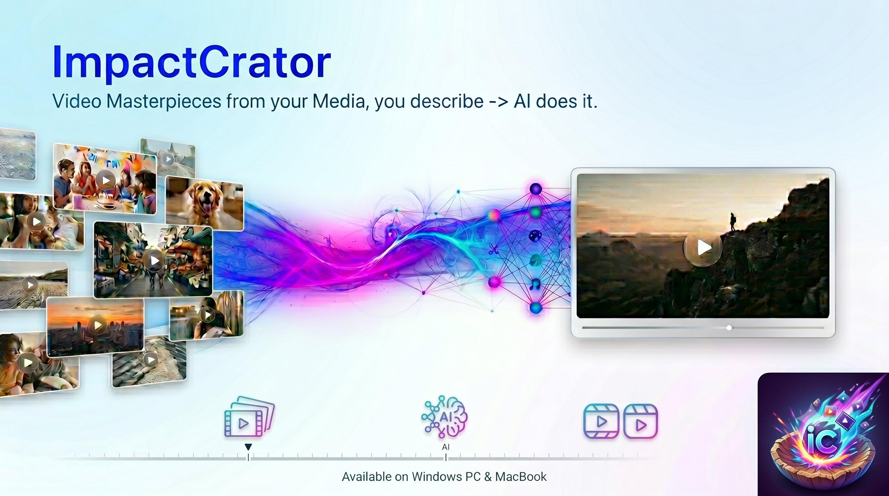
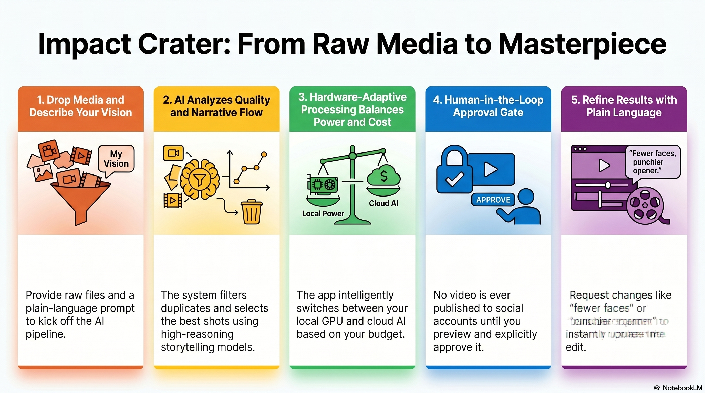
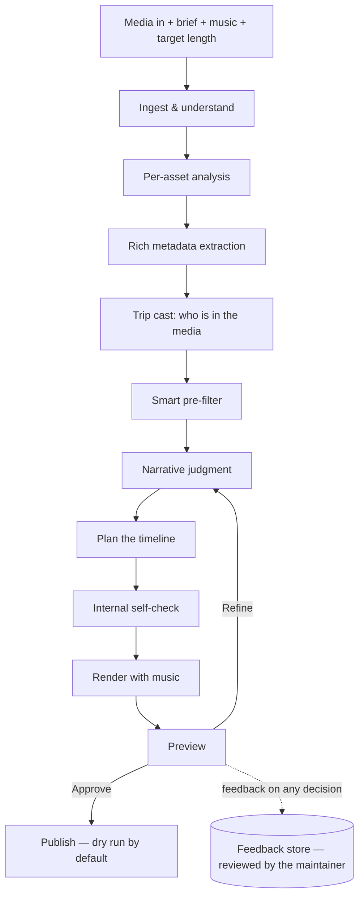
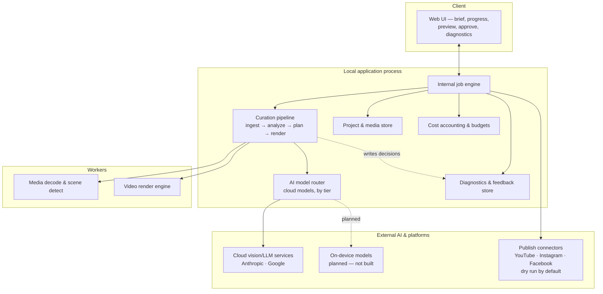
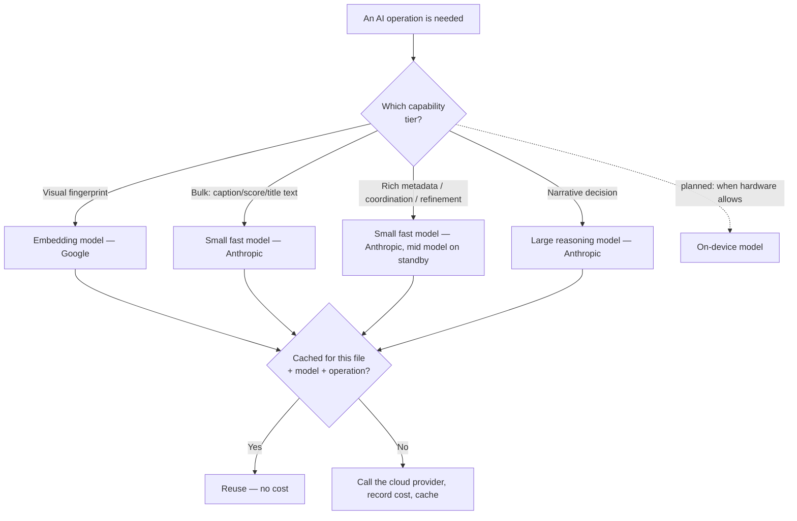
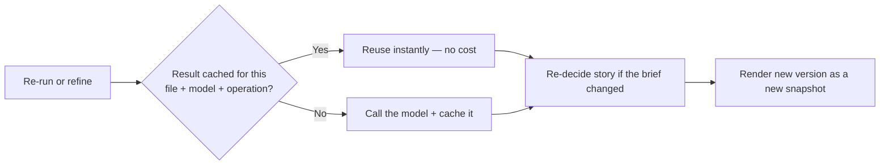

# Impact Crater — Product & Architecture Overview

*Reflects the application as of 2026-10-24 (restart audit); updated as the product changes.*

[](https://notebooklm.google.com/notebook/d7db525d-d686-47d9-995b-211092185d03/artifact/39a9e5a9-eccb-4cd2-a52a-9d07423c4eb0?utm_source=nlm_web_share&utm_medium=google_oo&utm_campaign=art_share_1&utm_content=&utm_smc=nlm_web_share_google_oo_art_share_1_)

**[▶ Watch the video overview](https://notebooklm.google.com/notebook/d7db525d-d686-47d9-995b-211092185d03/artifact/39a9e5a9-eccb-4cd2-a52a-9d07423c4eb0?utm_source=nlm_web_share&utm_medium=google_oo&utm_campaign=art_share_1&utm_content=&utm_smc=nlm_web_share_google_oo_art_share_1_)** (preview produced in June 2026)



*(preview produced in June 2026 — the "hardware-adaptive" processing it pictures is a design goal; see §9 for what runs where today)*

> **What this document is.** A single, self-contained explanation of the whole
> application: what it does, what it produces, how it works end to end, the
> techniques behind it, its architecture and key flows, and where it is headed.
> It is written for a general audience — no internal tracking codes or
> shorthand — and is meant to be readable on its own (including by tools that
> generate presentations or summaries from it).
>
> **It is a consolidated mirror, not the working notes.** The team keeps
> detailed, fast-moving design notes elsewhere; this document is the stable,
> outward-facing summary and should be refreshed whenever the product's
> features, architecture, flows, or core design change. Where a capability is
> designed but not yet real, this document says so.

---

## 1. What Impact Crater is

**Impact Crater turns a pile of your photos and videos into finished,
ready-to-share videos in one click.** You point it at a folder of raw media —
often thousands of photos and videos from a trip, event, or shoot — describe in
your own words what video(s) you want and which platform(s) they are for ("a
one-minute video of our Zion hike, building to the canyon overlook, scored to
this song, for YouTube"), click submit, and you're done. The AI does the rest —
prepare, plan, create — and, once you approve a preview, hands the result to a
publishing step that can post it to YouTube once the owner has supplied YouTube credentials (today through environment variables; there is no in-app account connection yet).
Under the hood it is a careful media curator, picking the best moments and
sequencing them into a narrative fitted to music — but to you it's one action.

It also gets faster and cheaper the more you use it: it caches its analysis so
it never re-examines the same photo twice, works out who each trip is about,
and keeps every decision inspectable so you can flag anything you disagree
with — all in service of that single click, never as knobs you have to set.
Learning your taste across projects is planned (see §13), not yet real.

It is **self-hosted first**: it runs as a local application on your own
machine, and your media stays on your disk. Today the AI reasoning itself runs
on cloud AI services (Anthropic and Google) that you configure with your own
API keys, within spending limits you set; the architecture leaves a slot for
on-device models so that a capable workstation can later do more of the work
locally. The same product can later run as a hosted service without a rewrite.

### The core promise

> Drop in a folder of media, describe what you want in plain language, click
> submit, and come back to a finished, ready-to-share video — with a hard rule
> that nothing is published until you say so.

---

## 2. Who it's for, and the problem it solves

People come home from a trip or an event with hundreds or thousands of photos
and videos and **never make anything with them** — editing is tedious, picking
the best shots is overwhelming, and matching footage to music is a craft most
people don't have time to learn.

Impact Crater removes that friction. It does the selection, sequencing, music
matching, and rendering automatically, while keeping the person in control of
the final result. The target user is someone who wants beautiful, shareable
videos from their own media without spending hours in an editor.

---

## 3. Guiding principles

- **Self-hosted first.** Runs on your machine; your original files never leave
  it — re-encoded copies of photos (about 1024 px) and video frames at their own size go to the AI providers you configure. A
  hosted-service mode is a future configuration, not a different product.
- **Cloud today, on-device by design.** Every AI call goes to a cloud provider
  today. The model router is built so on-device models can be slotted in per
  operation later; automatic balancing by GPU/VRAM is a roadmap item, not a
  shipped feature.
- **Preview, then approve — always.** The system never posts anything publicly
  without an explicit human approval step. This gate is fundamental — and today
  publishing additionally defaults to a dry run that posts nothing at all.
- **Transparent.** Every decision is inspectable: what was kept, what was
  dropped and why, how the story was ordered, what each step cost.
- **Privacy-honest.** Analysis sends re-encoded copies of your photos (about 1024 px) and video frames at their own size —
  including the faces in them — to the cloud providers you configure.
  Stripping location data and blurring faces are designed and partly built but
  not yet enforced, and the app does not yet promise local-only handling or
  deletion; see §11 for exactly what is and isn't true.
- **Cost-conscious.** Cheap, fast models do the bulk work; an expensive,
  high-reasoning model is used sparingly. Results are cached so re-runs are
  nearly free. You set a daily spending cap up front, checked before a job
  starts.

---

## 4. What you can create

**Available today**

- **Story Video** — a single themed video built from your media with a
  background music track, rendered for landscape (16:9, 1080p) viewing. It can
  be published to YouTube once the owner has supplied YouTube credentials (environment variables today; no in-app connect yet); publishing runs in
  dry-run mode by default, so nothing is posted until you switch it on. Two
  modes:
  - **Standard** — your music plays under a narrative cut of the best moments.
  - **Music-video** — the cuts are synchronized to the beat of your song, and
    you can describe which parts of the song should map to which kinds of footage
    ("the build-up over the climb, the chorus on the summit") in plain language.
    In both modes the song's section structure and mood inform which footage
    lands where.
  - **Optional title card** — you can opt in to an opening splash screen that
    captures the video's spirit: an AI-generated background with the trip's main
    people, a fitting title, and the year. If image generation isn't available it
    falls back to a typographic title over one of your own photos, so it never
    blocks your video.
  - **Snappy, fully-covering pacing** — the cut favours many short moments
    (roughly two to three seconds each) over a few long-held photos, caps how
    many clips can come from any one viewpoint, asks the story step to represent
    every place your brief names, and can occasionally use a rapid
    **burst-montage** — several same-place photos flashed in a two-to-four-second
    sequence — when a spot has a lot of similar shots. (An even day-by-day budget
    exists in the code but is switched off pending evaluation.)

**On the roadmap** (described in §13)

- Per-location reels and short-form clips, multi-photo albums and collages, a
  full music-scored journey video, and — the headline future capability — the
  **Trip Package**: drop an entire multi-day trip and receive a *coordinated set*
  of videos and reels (one per place or event), plus an overall trip film and a
  montage, all planned automatically.

---

## 5. How it works — what the AI does behind your single click

Everything below happens automatically behind your single click — you never
operate any of it; here is what the AI does for you. A job moves through a
sequence of phases. The first phases **prepare** (extract everything knowable
from the media); the middle phases **plan** (decide what the video should be);
the last phases **produce** — and, once you approve, **publish**.



### The preparation phases

1. **Ingest & understand the media.** Every file is fingerprinted (a content
   hash that uniquely identifies it), thumbnailed, and — for videos —
   automatically split into scenes, with long scenes further subdivided so a
   single long take isn't under-sampled. Crucially, the system reconciles **when
   each item was captured** from three sources in order of reliability — the
   photo's embedded timestamp, the filename, and the file's modified date —
   and reads **GPS coordinates** where present. This gives the rest of the
   pipeline a real timeline and real locations to work with.

2. **Per-asset analysis.** For every photo and every video scene, a fast cloud
   model produces a one-line caption, a technical-quality score (focus,
   exposure, framing, motion blur), a relevance score against your brief, and a
   numeric "visual fingerprint" (an embedding) used later to spot
   near-duplicates.

3. **Rich metadata extraction.** A more capable vision model describes each
   shot in depth: the people in it and their facial expressions, who the main
   subjects are versus incidental bystanders, the activity, the scenery and
   background, the lighting, time of day and mood, the cinematographic shot
   type (wide, establishing, close-up, …), an "is this an intrinsically special
   shot" score, a content-safety rating, and whether anything is obstructing the
   shot. Every answer is checked against a strict schema and retried once if it
   doesn't fit.

4. **Trip cast — who is in the media.** The system detects faces across the
   whole set (locally, with a bundled detector), turns each face into an
   identity fingerprint (via the cloud embedding model by default), groups them
   into unique people, and infers who belongs to the *group the trip is about*
   versus *incidental crowd* — using how broadly a person recurs (across
   different days and different places), not just how often they appear. This
   lets curation be people-aware, and the diagnostics show you the cast it
   found. (A separate, hand-maintained people list exists in the app but is not
   yet connected to curation.)

### The planning phases

5. **Smart pre-filter.** A fast, rule-based step narrows thousands of items down
   to a strong candidate set: it removes unsafe frames and too-short video
   scenes, drops anything below a quality floor (rescuing genuinely special
   shots), collapses bursts of near-identical retakes down to the single best
   shot (using both pixel-level similarity and the visual-fingerprint similarity
   within a short time window), thins out over-photographed locations, reserves
   room for the places your brief names, and ranks what remains by a blend of
   quality, brief-relevance, specialness, and diversity.

6. **Narrative judgment.** A high-reasoning AI model acts as the storytelling
   brain. In a single pass it reviews the candidate set — with each item's
   caption, metadata, expressions, shot type, and **capture time** — and
   produces the ordered story: which shots, in what sequence, with what role
   (opener, scene-setter, peak, callback, closer). It defaults to a
   forward-in-time flow but will deviate for a strong opener or to honor your
   brief, keeps a healthy share of real motion footage, balances people against
   scenery, matches the song's mood, and explains its reasoning.

7. **Plan the timeline.** The chosen story is compiled into a concrete plan:
   per-clip durations, how each shot is framed to fit the output dimensions
   (smart-crop, letterbox, etc.), the per-viewpoint cap and any burst-montages,
   and — in music-video mode — the cut points snapped to the song's beat grid.
   If you opted in, the title card is generated here and placed first.

8. **Internal self-check.** A separate AI pass sanity-checks the compiled plan
   and proposes small, typed changes (drop, reorder, shorten, lengthen, swap).
   Only when it is very confident are they applied automatically; otherwise its
   notes are saved with the version and the plan proceeds as-is. Nothing from
   this step is shown to you in the interface yet — a review-and-confirm view is
   on the roadmap.

### The production phases

9. **Render with music.** A video-processing engine assembles the clips into a
   finished 1080p file, normalizes the audio to a broadcast-friendly loudness
   with smooth fades, and muxes everything into a standard, widely-compatible
   video. You can cancel a running job at any point; the analysis already done
   stays cached.

10. **Preview, approve, publish.** You watch the result. Two clear actions:
    **Approve & publish** opens a publish form where you pick the platform, a
    title and description, and the visibility (private, unlisted, or public),
    and see whether that platform has credentials and whether dry-run is on;
    or **Refine**. Publishing runs in dry-run mode by default: the request is
    validated and written to the audit log, but nothing is posted until the
    owner supplies credentials and turns live posting on (see §7).

11. **Refine.** Tell it what to change in plain language — anything, not from a
    fixed menu: "insert more photos of Las Vegas," "don't drop Las Vegas even if
    those shots are lower quality," "make the clips at the beginning 50% longer and
    shrink the photos around them," "hold photos longer as the music builds," "more
    landscape, fewer faces." In one structured request it *interprets* your words
    against the analysis it already has, then pulls the right levers: **re-time**
    the same clips (pacing/emphasis, no re-judge — fast), **guarantee coverage**
    of a place it under-showed, **re-tell** the story with a new emphasis, or
    adjust the title card — and renders a new version as its own snapshot, which
    opens in the inspect view (without its own per-decision diagnostics or cost summary yet — only the original has those) while the original stays
    untouched. It explains what it did, or why a request isn't possible with
    your media. Re-runs reuse cached analysis, so refinement is fast and cheap.
    Today you wait on the refinement as a single request, and the refined
    version can be viewed and inspected but not itself refined again or
    published from the interface; a side-by-side comparison is on the roadmap.

12. **Feedback.** At any point you can open per-phase diagnostics (live while a
    job runs, or afterward) and mark any individual decision — a kept/dropped
    shot, a selection, a person classification — as correct, incorrect, or
    "should be different," with a note and an automatic screenshot of what you
    were seeing. You can also react at a higher level: on the **whole video**
    ("great pacing," "too short") or on an **entire phase** ("over-covered one
    spot"), not only on single decisions. While a job runs, the live view breaks
    each phase into the individual modules working — fingerprinting, reading
    capture times and GPS, scoring shots, picking keepers, composing the story —
    so you can see and trust what the AI is doing. All of this feedback is
    stored locally, with a tracker page where its status can be followed, for
    the maintainer to act on — tuning thresholds, editing prompts, or adding
    new steps. The system does not yet change its own behaviour from it: a
    cross-project taste profile is planned (the storage and endpoints exist,
    but nothing feeds them yet).

---

## 6. The techniques that make it work

- **Capture-time reconciliation.** Treats "when was this taken" as a
  confidence-scored signal merged from EXIF, filename patterns (phone, app, and
  screenshot conventions), and file dates — so the story can follow real
  chronology even when one source is missing or misleading.
- **Two-stage duplicate suppression.** Pixel-level perceptual hashing catches
  near-identical frames; visual-fingerprint similarity within a time window
  catches *retakes of the same moment from a slightly different angle* that pixel
  hashing misses — keeping only the best of each burst.
- **Cheap-first analysis.** The heavy per-item analysis runs on small,
  downscaled renditions (about 1024 px) of photos rather than full-resolution originals (video scene frames are sent at their extracted size) —
  roughly an order of magnitude less data moved per item — with no loss of
  analytical quality, because the cache is keyed on the original file, not the
  bytes sent to the model.
- **Model tiering.** Work is routed to the cheapest model that can do it well:
  a small fast model for captions, scores, the title text, rich metadata and
  internal coordination (a mid model stays configured as the fallback for the
  metadata work), a dedicated embedding model for the visual fingerprints, and a
  large high-reasoning model used *once per job* for the narrative decision.
- **Content-addressed caching.** Every analysis result is cached by a key
  combining the file's content hash, the model, the model version, and the
  exact operation — so the same photo is never analyzed twice across jobs, and a
  re-run or refinement reuses everything still valid.
- **Narrative-arc-as-judge.** Rather than scoring shots in isolation, a single
  high-reasoning pass composes the whole ordered story at once, which produces
  far more coherent results than greedy per-shot selection.
- **Beat-synchronized cutting.** For music videos, the song is analyzed for beats
  and sections, a cut grid is generated, and clip boundaries snap to it; a
  plain-language mapping lets you steer which footage lands on which part of the
  song.
- **Recurrence-breadth group detection.** Distinguishes the people a trip is
  *about* from background strangers by how broadly someone recurs across days and
  locations — so a tour guide who appears many times at one stop stays
  "crowd," while a companion seen across the whole trip is "group."
- **Structured, schema-checked AI decisions.** Every structured AI call (metadata, brief parsing, the narrative decision, the self-check, refinement planning, the title text) returns a typed result
  validated against a schema; optional steps (brief parsing, music analysis,
  the self-check, the title card) are fail-soft, so a hiccup in one never
  blocks your video.
- **Privacy transforms (designed, not yet enforced).** A library can strip
  embedded metadata (or just GPS) and blur detected faces before an image is
  sent to a cloud model, and the router is designed to keep face-related work
  on-device when blurring is on. Neither is wired into the job path today, and
  no on-device model exists to route to.
- **Cross-project learning (planned).** A durable preference profile derived
  from your approvals, refinements and feedback is designed, with its storage
  and endpoints in place — but no part of the app records events into it yet
  and nothing reads it, so defaults do not adapt today.

---

## 7. Architecture

Impact Crater runs as a **single local application**: one web-server process
that hosts the user interface, the internal job-execution engine, the AI-model
router, and the project store, and that runs heavy media work (decoding, scene
detection, rendering) through a bounded worker pool, with the video encoder as
managed subprocesses. It is started with one command (`impact-crater`) and used in your
browser.



**The layers**

- **User interface** — where you point at a media folder, write the brief,
  choose music and length, pick an effort level, watch progress, preview the
  result, give feedback, and approve publishing. A modern web front-end served
  by the local app, with a dashboard of your projects and finished videos.
- **Project & media store** — your source media stays where it is (referenced
  by path and identified by content hash, never copied), while the app keeps its
  own thumbnails, downscaled renditions and per-video scene frames, per-project
  metadata, and an immutable **snapshot** for every render so versions and
  refinements form a clean history.
- **Curation pipeline** — the staged path from raw media to a finished video,
  described in §5.
- **AI model router** — a single abstraction every AI call goes through. It
  maps each kind of operation to a provider and model by tier (today: Anthropic
  for captions, scores, the title text, rich metadata, brief parsing, internal
  coordination and the narrative decision; Google for the visual fingerprints
  and the optional title-card image), validates structured output, retries transient
  failures, records cost, and serves the cache. Hardware and privacy constraints
  are design slots in this layer, not enforced rules today.
- **Render engine** — runs the actual video assembly as managed subprocesses
  through the worker pool, cancellable mid-render. A job interrupted by a
  server restart is lost (its finished videos and cached analysis are not —
  see §10).
- **Cost accounting & budgets** — records what each operation costs, summarizes
  per-job spend, and enforces the daily caps you configure by checking them
  before a job starts.
- **Diagnostics & feedback store** — persists every phase's decisions with each
  version and captures your decision-level feedback (with screenshots) for the
  maintainer. The cross-project taste profile has its storage and endpoints
  here but is not fed yet.
- **Publishing connectors** — adapters for YouTube, Instagram Reels, and
  Facebook Page video. Credentials are read from environment variables set by
  the owner (no account is connected out of the box; a Settings-based connect
  flow is on the roadmap); publishing runs in dry-run mode by default; and every
  publish attempt — including dry runs — is appended to a local audit log. The
  API keys for the AI providers, by contrast, are stored encrypted in the app's
  local database.

---

## 8. Key flows

### Creating a video (end to end)

```mermaid
sequenceDiagram
    actor User
    participant App
    participant AI as AI models (cloud)
    participant Render
    participant Platform

    User->>App: Point at media folder, brief, music, length; submit
    App->>App: Check daily spend cap; ingest, fingerprint, timeline, scenes
    App->>AI: Analyze each asset (small/medium models)
    App->>App: Build trip cast; smart pre-filter
    App->>AI: Decide the story (single high-reasoning pass)
    App->>App: Compile timeline; internal self-check
    App->>Render: Assemble clips + music
    Render-->>App: Finished video
    App-->>User: Preview + per-phase diagnostics
    User->>App: Approve (platform, title, visibility)
    App->>App: Dry run (default): validate, post nothing
    App->>Platform: Upload — only when live posting is on
    App->>App: Append audit record (dry run or live)
    App-->>User: "Dry-run validated" or the published link
```

### How a model is chosen (cloud models, by tier; on-device planned)



### Re-running and refining (why it's fast)



---

## 9. AI-model strategy

- **Three capability tiers.** A small, fast model handles the high-volume work
  (captions, quick scores, the title text, rich metadata, brief understanding,
  the self-check and refinement planning — a mid model stays configured as the
  fallback for the metadata work); a dedicated embedding model turns every image
  into its visual fingerprint; a large, high-reasoning model is reserved for the single most important
  decision — composing the narrative — used about once per job to keep cost
  down.
- **One interface, cloud providers today.** Every model sits behind one common
  interface with a per-operation routing table. Today that table points every
  operation at a cloud provider: Anthropic for captions, scores, metadata,
  coordination and the narrative decision; Google for the visual fingerprints
  and the optional title-card image. No on-device model runtime ships yet.
- **On-device models (planned).** The router has a slot for on-device models,
  intended to be capped at a size that runs on consumer GPUs so a capable
  workstation could keep more work local. The "hardware-adaptive routing" that
  would pick local or cloud per operation from your GPU/VRAM and spending
  limits is not implemented.
- **Privacy routing (planned).** Restricting face-related operations to
  on-device models when face-blurring is on is part of the design and depends on
  the item above; see §11 for what happens today.
- **Resilient.** Calls retry transient failures with limits, and structured
  answers are validated and retried once. On a permanent failure the job stops
  with a plain-language reason (for example, exhausted provider credits) and
  the analysis already done stays cached, so re-running the job picks up
  cheaply. A stopped job cannot be resumed in place — you start a new run.

---

## 10. Storage, versioning, and reproducibility

- Everything the app creates lives under a single application folder on your
  machine; your source media is **referenced, never copied**, and identified by
  content hash. (The app does not yet re-link source files you move.)
- Every render is an **immutable snapshot** with its full plan, outputs and
  diagnostics; refinements chain off their predecessor, giving a clean version
  history. A side-by-side comparison view is on the roadmap.
- A **content-addressed cache** means the same photo is never analyzed twice —
  across jobs, re-runs, and refinements — which is the main reason re-work is
  fast and cheap.
- Because results are cached by content and model version, **re-running a job
  reuses the same answers and reproduces the same cut** (the optional AI title-card image is generated fresh each time).
- **Live jobs are held in memory.** If the server restarts mid-job, that job is
  lost — its finished videos, diagnostics and cached analysis are not, and
  finished versions can always be re-opened from the dashboard and inspected.
  Durable jobs that survive a restart are on the roadmap.

---

## 11. Privacy, safety, and trust

- **What leaves your machine today.** Analysis sends re-encoded copies of your photos
  (about 1024 px; the original is sent only if that copy is missing) and video
  scene frames at the video's own frame size to the cloud
  AI providers you configure (Anthropic and Google), along with your brief and
  the captions derived from them. Those copies carry whatever is visible in the
  frame, faces included, with no blurring applied; they are re-encoded
  renditions, and embedded metadata such as GPS is read locally for the
  timeline rather than deliberately stripped. Face crops go to the cloud
  embedding model by default to group people. For the optional title card only
  a short text prompt is sent; faces are composited locally.
- **Location and face protections — designed, not yet enforced.** Stripping
  embedded metadata (or only GPS) and blurring faces before cloud calls exist as
  a library, but no step of a job applies them, and the Settings page currently
  shows these as fixed descriptive text rather than working controls.
  Per-project privacy settings are planned.
- **Content-safety gate.** Frames the metadata model rates as explicit are
  removed before they can ever reach a finished, shareable video.
- **Publish only on approval.** Nothing is posted publicly without an explicit
  approval step in which you choose the platform and visibility. Today
  publishing additionally defaults to a dry run, so nothing is posted until the
  owner turns live posting on — and every attempt, dry run or live, is appended
  to a local audit log.
- **Your data stays on your machine — with one gap.** Self-hosted; the app's
  own telemetry (per-call cost and timing) is written to a local file and sent
  nowhere; AI-provider API keys are stored encrypted in the local database.
  There is not yet a way to delete a project's derived data (thumbnails,
  analysis cache, versions) from within the app.

---

## 12. Cost transparency and control

- **Spending caps you set up front** — a total daily limit, plus optional
  per-provider limits (Anthropic, Google), all hard. They are checked before a
  job starts: a job whose pessimistic estimate would breach a cap is refused.
  There is no mid-job cut-off yet; spend is recorded live as each call
  completes.
- **A ballpark estimate before you start** — you pick an effort level (a size envelope that drives the cost estimate; today it does not change what the job processes — the whole folder is analysed) and see a low-to-high dollar range
  for it and whether it fits today's remaining budget.
- **Live spend** is shown while a job runs, broken down by kind of work (quick
  analysis, detailed analysis, story composition, visual fingerprints) and by
  provider, alongside a cache hit-rate so you can see how much re-use is
  saving.
- **Per-job cost summary** is saved with every result.
- The cheap-first analysis, model tiering, and caching together keep a typical
  job inexpensive and a refinement cheaper still.

---

## 13. Roadmap

**Available now** — the local application; the full prepare-plan-produce
pipeline; Story Videos (standard and music-video) rendered at 1080p landscape,
with the optional title card; the preview-then-approve gate; daily spending
caps and the pre-job estimate; the auto-derived trip cast; plain-language
refinement; the in-app diagnostics-and-feedback system; and YouTube, Instagram
Reels and Facebook Page video connectors that run in dry-run mode until the
owner supplies credentials and switches live posting on.

**Validated on a real trip (June 2026).** The curate-and-preview half ran end
to end on a 1,663-item trip (1,481 photos and 182 videos, about 2,000 shots
after scene detection) and produced a publish-ready 108-second Story Video —
roughly four hours and about $50 of cloud AI in total, spread over a cold run
that stopped on exhausted provider credits and a cheaper warm re-run that
reused the cache. The publish half has never run for real: no video has yet
been posted anywhere, and no account is connected out of the box.

**Available today behind your own Meta credentials** — Instagram Reels and
Facebook Page video connectors exist and run in dry-run until you enable them;
they have not yet been exercised against the live platforms (Instagram also
needs the video reachable at a public web address). X is planned. Output is
landscape only today; 9:16 and 1:1 formatting for short-form platforms is on
the roadmap.

**Near-term** (in this order)

- **A first real publish, then a connect flow** — post a Story Video to YouTube
  for real (as a private video first), then connect accounts from Settings
  instead of environment variables.
- **A quality-evaluation harness** — measure curation quality against real
  trips so changes can be judged, not eyeballed.
- **Durable jobs** — a live job survives a server restart (today it does not;
  finished videos do).
- **Per-location reels and photo albums / collages**, with 9:16 and 1:1
  formatting for Instagram and Facebook, and an X connector.
- **AI-written titles and captions** for each post.
- **The taste profile** — turn the feedback you give into a cross-project
  profile that shapes defaults.
- **Working privacy controls** — strip metadata, blur faces, per-project
  settings — and a way to delete a project's derived data.
- **Power-user polish** — side-by-side version comparison, refining and
  publishing a refined version directly, the self-check's suggestions as a
  review step, richer cost dashboards, and more music-sourcing options.
- **On-device models, later in this list** — an on-device model runtime behind
  the existing router slot, then hardware-aware routing and keeping
  face-related work local.

**Later**

- **The Trip Package** — the headline future capability: drop a whole multi-day
  trip and the system figures out, from the media itself, how many videos it
  deserves and where the boundaries are — a richly-documented hike becomes its
  own film, thin moments are combined, standout moments become short reels — and
  delivers a coordinated package (per-place videos, reels, an overall trip film,
  and a montage) from a single analysis pass, all behind one approval surface.
- **Live jobs** — continuously ingest media *during* an event and produce
  multiple outputs from one growing source set.
- **Style learning** — learn the look and pacing you like from reference videos
  and apply it to selection and editing.
- **Auto photo/video editing** — per-shot color, exposure, and contrast
  improvements.
- **Mobile companion app**, **conversational refinement**, **AI-generated music**,
  **automatic removal of background strangers** from selected shots, and a
  **hosted multi-tenant service** mode.

---

## 14. Licensing and openness

Impact Crater is open source under the Business Source License 1.1, which is
free to self-host for personal, family, or internal team use and converts to a
fully permissive license on its change date. Hosting it as a paid service to
third parties is reserved until then. The design is deliberately structured so
that a future hosted-service offering is a configuration change rather than a
re-architecture.

---

## 15. Glossary

- **Brief** — the plain-language description you give of the video you want.
- **Story Video** — a single themed, music-backed video; the product's core output.
- **Standard vs music-video mode** — music under a narrative cut, vs cuts
  synchronized to the song's beat.
- **Pipeline / phases** — the internal ordered steps the AI runs automatically
  behind your single click, from ingesting media to rendering (and, once you
  approve, publishing); you watch them happen rather than operate them.
- **Effort level** — the size envelope you pick before a job (a size envelope that drives the cost estimate; today it does not change what the job processes — the whole folder is analysed), which drives the ballpark cost estimate.
- **Trip cast** — the set of unique people the system finds in your media, split
  into the group the trip is about versus incidental crowd.
- **Snapshot** — an immutable saved version of a render, including its plan and
  diagnostics; a refinement produces a new one.
- **Embedding / visual fingerprint** — a numeric representation of an image used
  to measure visual similarity.
- **Model tier** — the small/mid/large grouping of AI models by capability and cost.
- **Render** — assembling the chosen clips and music into a finished video file.
- **Dry run** — a publish attempt that validates everything and writes an audit
  record but posts nothing; the default until the owner switches live posting on.
- **Audit log** — the local, append-only record of every publish attempt, dry
  runs included.
- **Diagnostics & feedback** — the in-app view of every decision a job made, and
  the ability to flag any of them for the maintainer to act on.
