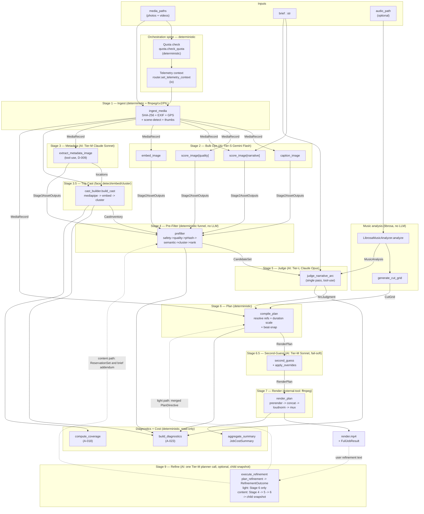

# Job Data Flow — Every Module the Media Passes Through, Start to Finish

> **What this is.** An internal engineering reference that traces a single job end-to-end through *every* module — algorithmic, prompt-based, AI and non-AI — from the input media to the rendered MP4. Each step is labelled by kind (AI-prompt / AI-embedding / deterministic-algorithm / external-tool / io) with its file, model/prompt, inputs → outputs, and cache/cost behaviour. Unlike [`OVERVIEW.md`](../OVERVIEW.md) (the jargon-free external mirror), this doc is deliberately code-level: module names, file paths, schemas, and prompts are all here.
>
> **Purpose.** Feed it to tools like Google NotebookLM to visualize how the media is processed into the output; it doubles as a precise onboarding + debugging map of the curation pipeline.
>
> **Maintenance.** This is a maintained mirror of the code. The `knowledge-curator` skill refreshes it whenever the pipeline modules, data objects, or prompts change. If it ever drifts from the code, the code wins.
>
> **Last synced:** 2026-10-25 — refreshed from the code: Stage 9 (one `RefinementOutcome` planner call → child snapshot, from `stage9_refine.py` / `api/snapshots.py` / `plan_directive.py` / `destinations.py`), the Stage 9 node in the top-level diagram, the Data Objects table (`RefinementOutcome`, `PlanDirective`, `ReservationSet`), the Prompts Appendix (seven live templates and the 2026-07-01 model pins), the Stage 2 embedding model, and one-line notes on the Stage 3.5 merge pass, the Stage 4 must-keep / stratified budget and the Stage 6 `PlanDirective`. Same day, after the S-2.13.7 dead-code sweep: the Stage 3 text and the Data Objects row say video-scene frames go through `extract_metadata_image` with the `RichMetadataVideoScene` schema (a separate video-scene op never existed), the live-progress WebSocket path reads `/api/jobs/ws/{job_id}`, and `config/llm-routing.yaml` routes nine operations — the set the Routing bullet below describes. Line numbers in rows not listed here date from 2026-06-18 and have drifted; treat `file::function` as the anchor. Previous sync: 2026-06-18 (mapped from an 8-subsystem code read).

## 1. Introduction

### What a "job" is

A **job** is one end-to-end invocation of the Impact Crater pipeline: a user supplies a pile of photo/video files plus a free-text **brief** (and optionally a music track), and the system produces a finished, rendered MP4 video — after a preview-and-approve gate. Internally a job is identified by a `job_id` (lifecycle/registry scope) and produces one or more `snapshot_id`s (each snapshot is a concrete plan + render, so refinements create new snapshots without destroying the old).

### Input → output contract

| | |
|---|---|
| **Inputs** | `media_paths: list[Path]` (photos + videos), `brief: str`, optional `audio_path: Path`, a `FullJobConfig` (mode, target duration, overrides), and a shared `LLMRouter`. |
| **Output** | `FullJobResult` → a rendered `render.mp4`, plus a snapshot directory of artifacts: `plan.json`, `diagnostics.json`, `cost_summary.json`, `second_guess.json`, `coverage.json`, and `cast.json`. |

### The stage spine

The pipeline runs through **7 numbered stages** plus three side/extension steps. Two orchestration entry points wrap them:

- **`run_headless_pipeline`** — Stages **1–5** (ingest → curation/judgment). Pure analysis; no render.
- **`run_full_pipeline`** — wraps the headless runner and adds music analysis, **Stage 6** (plan), Stage 6.5 (second-guess), and **Stage 7** (render).

| Stage | Name | Kind | One-line role |
|---|---|---|---|
| **1** | Ingest / Prep | deterministic + external-tool | Hash, capture-time, GPS, scene-detect, thumbnails, sidecars |
| **2** | Bulk Ops | AI (Tier-S Gemini) | Caption + quality score + narrative score + embedding per asset |
| **3** | Rich Metadata | AI (Tier-M Claude Sonnet) | Structured per-asset metadata (D-009 schema) via tool-use |
| **3.5** | Trip Cast | external-tool + AI-embedding | Face detect → embed → cluster → CastInventory (fail-soft) |
| **4** | Pre-Filter | deterministic | 6-step funnel → bounded CandidateSet (no LLM) |
| **5** | Narrative-Arc Judge | AI (Tier-L Claude Opus) | The selection + ordering decision → ArcJudgment |
| **6** | Compile Plan | deterministic | ArcJudgment → RenderPlan (durations, aspect, beat-snap) |
| **6.5** | Second-Guess | AI (Tier-M Claude Sonnet) | Sanity-check overrides, fail-soft |
| **7** | Render | external-tool (ffmpeg) | Pre-render → concat → loudnorm → mux → MP4 |
| **9** | Refine | AI (Tier-M/L Claude) | Free-text request → RefinementOutcome → the right lever (pacing directive / destination reservation / re-judge / title-card edit) → child snapshot (E-2.12) |

Surrounding all stages: a pre-job **quota check**, **telemetry context** setup, per-phase **diagnostics** (A-023), a cast **coverage report** (A-018), and post-job **cost aggregation**.

---

## 2. Top-Level Data Flow

**AI vs non-AI at a glance:** Stages **2, 3, 5, 6.5, 9** and Stage 3.5's embedding call are **AI**. Stages **1, 4, 6**, music analysis, diagnostics, coverage, cost, and Stage 3.5's detect/cluster are **deterministic / external-tool**. The orchestration spine (quota, telemetry, sequencing, exception mapping) is deterministic.

---

## 3. Per-Stage Detail

### Stage 1 — Ingest / Prep

**Flow.** Each file is classified (`photo`/`video`), SHA-256 hashed (the stable content-addressed ID), and dispatched to a worker pool. **Photos**: decoded with Pillow + `pillow_heif`, EXIF-transposed, perceptual-hashed (pHash/dHash), and rendered into 256px (UI) + 1024px (LLM-vision) thumbnails; capture-time is resolved by a confidence ladder (EXIF 1.0 → filename 0.8 → mtime 0.4), and GPS is decoded from EXIF DMS. **Videos**: probed with OpenCV, scene-detected via `scenedetect.ContentDetector`, long scenes (>12s) subdivided to ~8s, and 3 representative frames (start/middle/end) extracted per scene. Everything is written idempotently to the `media`/`project_media` SQLite tables, a `sources/{hash}.json` sidecar, and per-video `scenes.json`. An optional **privacy pipeline** (EXIF strip + face blur per ADR-0016) can transform bytes before they reach any LLM.

| Step | Module / function (file) | Kind | Model / Prompt | In → Out | Cache / Cost |
|---|---|---|---|---|---|
| Classify | `_classify` (stage1_ingest.py:451) | deterministic | — | path → MediaType\|None | — |
| Content hash | `_sha256_file` (stage1_ingest.py:460) | deterministic | — | path → content_hash | content-addressed ID |
| Photo decode + transpose | `_ingest_photo` (stage1_ingest.py:185) | external-tool | Pillow + pillow_heif; `exif_transpose` | path → RGB image, w/h | — |
| Perceptual hash | `imagehash.phash/dhash` (stage1_ingest.py:200) | deterministic | imagehash | image → phash_hex, dhash_hex | dedup keys (M0, A-011) |
| Thumbnails | `_write_thumbnail` (stage1_ingest.py:240) | deterministic | Pillow LANCZOS | image → 256/1024 JPEG | cached by content_hash |
| EXIF capture-time | `extract_capture_time` (timeline.py:68) | deterministic | piexif | path → CaptureTime(ts, source, conf) | — |
| Filename datetime | `_filename_datetime` (timeline.py:228) | deterministic | regex (PXL/IMG/WhatsApp/ISO) | name → dt (conf 0.8) | — |
| mtime fallback | `_file_mtime` (timeline.py:254) | deterministic | — | path → dt (conf 0.4) | — |
| GPS extract | `extract_gps` (timeline.py:90) | deterministic | piexif DMS→decimal | path → GpsCoord\|None | photos only |
| Video probe | `_ingest_video` (stage1_ingest.py:249) | external-tool | cv2.VideoCapture | path → w/h/fps/frames/duration | — |
| Scene detect | `_detect_scenes` (stage1_ingest.py:318) | external-tool | scenedetect ContentDetector | path → list[SceneRecord] | capped at scene_cap=50 |
| Long-scene subdivide | `_subdivide_long_scenes` (stage1_ingest.py:370) | deterministic | A-016 | scenes → finer scenes (~8s) | — |
| Frame extract (3/scene) | `_extract_frames` (stage1_ingest.py:413) | external-tool | cv2 PROP_POS_FRAMES + imwrite | scene → 3 PNGs | — |
| Media upsert | `_persist` (stage1_ingest.py:514) | io | SQLite UPSERT on content_hash | MediaRecord → media row | idempotent, COALESCE backfill |
| project_media join | `_persist` (stage1_ingest.py:549) | io | SQLite INSERT OR IGNORE | (project,hash) → row | cross-job reuse |
| Source sidecar | `_persist` (stage1_ingest.py:475) | io | json | MediaRecord → sources/{hash}.json | offline resume |
| scenes.json sidecar | (stage1_ingest.py:274) | io | json | scenes → cache/scenes/{hash}/scenes.json | idempotent |
| Privacy: EXIF strip | `strip_exif` (privacy.py:60) | deterministic | piexif (off/gps_only/all) | bytes → bytes | ADR-0016 |
| Privacy: face blur | `blur_faces` (privacy.py:113) | external-tool | mediapipe boxes + PIL blur | bytes → JPEG | fail-soft no-op |
| Privacy orchestrator | `prepare_for_llm` (privacy.py:160) | orchestration | — | path+posture → bytes | cached by hash+posture token |
| Parallel ingest | `ingest_media` (stage1_ingest.py:119) | orchestration | pool.submit_many('cpu') | paths → list[MediaRecord] | drops unrecognized |

### Stage 2 — Bulk Ops (captions, scores, embeddings)

**Flow.** Each photo (one asset) and each video scene (one asset, middle frame) is enumerated; a per-brief `brief_hash` (sha256[:16]) is computed. For every asset, **four operations run concurrently** through the `LLMRouter`: `caption_image`, `score_image[quality]`, `score_image[narrative_relevance]` (brief-aware), and `embed_image`. The router checks the content-addressed cache first; on a miss it dispatches to **Claude Haiku 5.5 (Tier-S, `effort: low`)** for the caption and the two scores and to **gemini-embedding-2** for the vector, captures token usage, prices via rate card, writes the payload (`.json` for text/scores, `.npy` for embeddings), emits an `LLMCallEvent`, and records quota spend. Per-asset failures are tolerated (Stage 4 handles gaps); a systemic all-fail raises. **Embedding:** `embed_image` sends the image bytes themselves (re-encoded to JPEG ≤ 1024 px when needed) to `gemini-embedding-2` with `output_dimensionality=768`; text and image vectors share one space. The caption-then-embed workaround that ran until 2026-10-25 (caption with Gemini Flash, embed the caption with `gemini-embedding-001`) is gone, and its vectors are incompatible with the new ones — the model_version change moves the cache namespace, and the 0.93 Stage 4 cosine threshold is re-tuned on the Zion fixture (S-3.10.1). The ADR-0018 local image embedder exists only as an interface + stub (`media/image_embed.py`, no callers).

| Step | Module / function (file) | Kind | Model / Prompt | In → Out | Cache / Cost |
|---|---|---|---|---|---|
| Enumerate assets | `_enumerate_assets` (stage2_bulk_ops.py:188) | deterministic | — | MediaRecords → list[_Asset] | scene index folded into cache key |
| Brief hash | `_short_hash` (stage2_bulk_ops.py:227) | deterministic | sha256[:16] | brief → brief_hash | invalidates narrative score only |
| Per-asset fan-out | `_run_for_asset` (stage2_bulk_ops.py:110) | orchestration | asyncio.gather ×4 | _Asset → Stage2AssetOutputs | each op cached independently |
| Caption | `caption_image` (router.py) → anthropic_client.py | AI-prompt | Claude Haiku 5.5 (`claude-haiku-5-5`, effort low) / `caption_image/anthropic_claude-haiku-5-5.jinja2` | bytes → caption ≤18 words | cache key: hash+op+prompt_ver |
| Quality score | `score_image` (router.py:168) | AI-prompt | Gemini Flash / `score_image/...jinja2` (dimension=quality) | bytes → float | stable key (no brief) |
| Narrative score | `score_image` (router.py:168) | AI-prompt | Gemini Flash (dimension=narrative, brief) | bytes+brief → float | key includes brief_hash |
| Embed | `embed_image` (router.py) → google_client.py | AI-embedding | gemini-embedding-2 on the image bytes (768-d; JPEG/PNG ≤ 1024 px re-encode first) | bytes → ndarray float32 | `.npy`, in-memory for Stage 4 |
| Cache get | `cache.get` (cache.py:96) | io | SQLite cache_index | key → payload\|None | hit ⇒ cost=0 |
| Token + rate card | `_record_call` (router.py:496) | deterministic | rate_cards.estimate_cost_usd | tokens → cost_usd | Tier-S ballpark ~$0.001 |
| Rate card load | `rate_cards.load` (rate_cards.py:48) | io | `config/rate-cards/anthropic-claude-haiku-5-5-2026-10-07.yaml` | provider/model → RateCard | LRU(128) |
| Cache put | `cache.put` (cache.py:136) | io | `.json`/`.npy` + index row | payload → disk | INSERT OR IGNORE |
| Telemetry emit | (router.py:567) | io | telemetry.emit(LLMCallEvent) | call → telemetry.jsonl | correlation_id stamped |
| Quota spend | (router.py:593) | io | quota.record_spend | cost>0 → quota_state | hits free |
| Assemble + aggregate | `_run_for_asset` / `run_stage2` (stage2_bulk_ops.py:155/76) | deterministic | — | 4 results → Stage2AssetOutputs | failed assets dropped |

### Stage 3 — Rich Metadata Extraction

**Flow.** Each asset's 1024px rendition is read and sent through `LLMRouter.extract_metadata_image`, which dispatches to **Anthropic Claude Sonnet (Tier-M)** using **forced tool-use** (`submit_metadata`, `input_schema` = the D-009 `RichMetadataPhoto` JSON schema). The rendered Jinja2 prompt carries the user's `context_brief`. The raw tool output is validated against the Pydantic model (coercion validators tolerate LLM malformations like CSV-string lists / tool-use XML leaks); results are cached on content_hash. Video scenes go through the same `extract_metadata_image` op (one representative frame per scene) with the `RichMetadataVideoScene` schema, which adds `scene_summary`; there is no separate video-scene operation (S-2.13.7).

| Step | Module / function (file) | Kind | Model / Prompt | In → Out | Cache / Cost |
|---|---|---|---|---|---|
| Enumerate assets | `_enumerate_assets` (stage3_metadata.py:202) | orchestration | — | MediaRecords → list[_Asset] | middle frame for video |
| Per-asset dispatch | `pool.submit_many_tolerant` (stage3_metadata.py:70) | orchestration | — | _Asset → Stage3AssetOutputs\|None | failures dropped unless all fail |
| Read bytes | (stage3_metadata.py:108) | io | — | path → image_bytes | 1024px (A-016) |
| Router dispatch | `extract_metadata_image` (router.py:226) | orchestration | — | bytes+schema → dict | key includes schema_hash |
| Cache get | `cache.get` (cache.py:96) | io | — | key → dict\|None | per content_hash |
| Prompt render | (router.py) | io | `extract_metadata_image/anthropic_claude-haiku-5-5.jinja2` | op+brief → rendered | sha256-versioned |
| LLM tool-use | `_extract_via_tool` (anthropic_client.py) | AI-prompt | Claude Haiku 5.5 (`claude-haiku-5-5`, effort low) / strict tool=`submit_metadata`, max_tokens=4096, no temperature | bytes+schema → metadata dict | Tier-M ~$0.0013 |
| Validate (D-009) | `_validate` (stage3_metadata.py:151) | deterministic | Pydantic RichMetadataPhoto | dict → RichMetadataPhoto\|VideoScene | coercion validators |
| Cache put | (router.py:262) | io | json sort_keys | dict → cache file | write-through on miss |
| Build output | (stage3_metadata.py:144) | deterministic | — | hash+meta → Stage3AssetOutputs | — |

### Stage 3.5 — Trip Cast (auto person inventory, A-018, fail-soft)

**Flow.** Runs in parallel with the main path. For each photo: read 1024px bytes → **detect faces** (mediapipe `mp.solutions` when present, else the OpenCV Haar cascade — mediapipe 0.10.35, the locked version, removed `mp.solutions`, so the Haar path is what runs on current installs; D-044) → **crop with 0.4 margin** (JPEG q90) → **embed each crop** via a pluggable `FaceEmbedder` (Gemini default via `router.embed_image` with `content_hash=face-{sha256[:24]}`, or local InsightFace ArcFace). Each face becomes a `FaceObservation` carrying embedding, capture timestamp, and a coarse `location_key` (GPS cell rounded to ~1.1km, else lowercased description). Faces are **greedy-clustered by cosine similarity** (threshold 0.82 Gemini / 0.45 InsightFace) into `Person`s; a centroid-level **merge pass** (`_merge_oversplit_clusters`, ADR-0020, default ON) then re-joins over-split clusters whose L2-normalised centroids are cosine ≥ 0.92 — never two clusters that share a photo — before the group/crowd gate; a person is **group** (the travel party) only when `appearance_count ≥ 3` **and** `distinct_days ≥ 2` **and** breadth (`distinct_days + distinct_locations`) `≥ 3` — a conjunctive gate (S-2.10.4) so a twice-seen passer-by or a face-detect false positive isn't promoted (the additive breadth alone over-counted; a fragment-merge pass + stricter detection are the remaining tightening) — else **crowd** (N-012). Output `CastInventory` is persisted to `cast.json`. Any failure (missing model, exception) yields `None` and the pipeline proceeds without cast.

| Step | Module / function (file) | Kind | Model / Prompt | In → Out | Cache / Cost |
|---|---|---|---|---|---|
| Collect locations | `build_cast` (cast_builder.py:42) | deterministic | — | stage3 → desc_by_hash | — |
| Read photo bytes | (cast_builder.py:50) | io | — | MediaRecord → bytes | fail-soft |
| Face detect | `detect_face_boxes` (_face_detect.py:28) | external-tool | mediapipe (sel=1, conf 0.5) → OpenCV Haar | bytes → list[Box] (normalized) | — |
| Crop faces | `detect_and_crop_faces` (cast.py:90) | deterministic | PIL, margin=0.4, q90 | bytes+boxes → crop bytes | skip <8px |
| Build embedder | `build_face_embedder` (face_embed.py:155) | orchestration | gemini\|insightface | backend → FaceEmbedder | — |
| Embed (Gemini) | `GeminiFaceEmbedder.embed_face_crops` (face_embed.py:63) | AI-embedding | gemini-embedding-2 (image bytes) via router.embed_image | crops → FaceVector\|None | `.npy`, key=face-{sha[:24]} |
| Embed (InsightFace) | `InsightFaceEmbedder` (face_embed.py:95) | external-tool | buffalo_l ArcFace, CPU | crops → FaceVector\|None | local, optional dep |
| Location key | `location_key` (cast.py:218) | deterministic | GPS round 2dp / desc[:40] | gps/desc → location_key | — |
| Accumulate | `build_cast` (cast_builder.py:48) | deterministic | — | crops+emb → FaceObservation[] | — |
| Cluster | `_cluster_faces` (cast.py:174) | deterministic | greedy cosine, running-mean centroid | observations → clusters | threshold per backend |
| Merge pass | `_merge_oversplit_clusters` (cast.py:250) | deterministic | centroid cosine ≥0.92; no merge when clusters share a photo | clusters → clusters | ADR-0020, `merge_oversplit=True` |
| Breadth + persons | `build_cast_inventory` (cast.py:127) | deterministic | breadth≥3 ⇒ group | clusters → list[Person] | — |
| Build inventory | (cast.py:72) | deterministic | — | persons → CastInventory | persisted to cast.json |
| Coverage | `compute_coverage` (cast.py:245) | deterministic | — | inventory+selected → CoverageReport | A-018 |

### Stage 0.5 — Brief intent (Tier-M, S-2.10.5, fail-soft)

**Flow.** Before Stage 4, `brief_intent.parse_brief` (reuses the `parse_user_brief`
op) extracts the **named destinations** the user wants covered (canonical name +
aliases + optional chronological order) and whether they asked for chronological
sequencing. Fail-soft: any error → empty intent → Stage 4 behaves as before.
`destinations.map_destinations` then maps each destination to matching media
(caption/location text + optional offline GPS reverse-geocode) and builds a
`ReservationSet` — a source-agnostic must-keep set. This is the shared coverage
lever: S-2.10.5 seeds it from the brief and the Stage 9 planner seeds it from
`reserve_destinations` / `reserve_refs` (`source="refinement"`); the `feedback`
source is declared on the type but no A-023 feedback code builds one yet (as of
2026-10-25).

### Stage 4 — Deterministic Pre-Filter (ADR-0011, no LLM)

**Flow.** Joins Stage 1+2+3 outputs into internal `_Asset`s, optionally annotates visible cast (A-018), then runs a funnel: **(0)** drop `explicit` safety frames; **(0b)** min-video floor — drop video scenes <2s natural (S-2.11.1: a sub-2s flash is jerky noise, ineligible before it can win a slot); **(1)** quality floor (`quality_score < 0.4` drop, **unless** `specialness_score ≥ 0.75` — a memorable-shot rescue, S-2.10.2); **(2)** pHash near-dup collapse (Hamming ≤5, keep top `⌈n/dedup_factor⌉`, specialness-aware tie-break); **(2b)** semantic best-of-burst dedup (A-017: L2-normalized embeddings, cosine ≥0.93 within 120s window; demands 0.97 when timestamps missing; keeps the most-special member); **(3)** location/time clustering (`time_of_day|location_description` buckets) downsampled to 10/bucket; **(3a)** burst-montage detection — dense same-backdrop bursts (≥6 photos within 1800s in a ~1km GPS cell, pHash Hamming ≤14) are annotated as `montage_groups` for Stage 6 to collapse into one ~0.5s-per-member sequence (S-2.11.4); **(3b)** per-viewpoint cap — ≤4 candidates per ~1km GPS cell, montage members exempt (T-2.11.1.6); **(4)** rank by `combined_score = α·quality + β·narrative + δ·specialness + γ·diversity` (defaults 0.25/0.40/0.20/0.15, diversity=1/cluster_size; S-2.10.2); **(5)** top-K to `target_size` within a floor (≥50 or 2×target_seconds) and ceiling (80% of input). Every drop/keep is logged for the transparency UI. Empties raise `Stage4EmptyCandidateSet` with funnel stats. Two levers sit around the funnel (S-2.10.5 / ADR-0020): a **`ReservationSet`** of must-keep keys — the brief's named-destination matches merged with any refinement reservations, capped at ~25 % of the target (`_cap_reservations`) — is exempt from the quality floor, dedup and viewpoint caps and is seated first in step (5) (`must_keep_forced`); and a **capture-day stratified budget** (`_stratified_take`, per-day floor 3 then round-robin) that would spread the remaining seats across days is implemented but **OFF** (`PreFilterOverrides.stratify_by_capture_day`, default False; nothing outside `stage4_prefilter.py` sets it), so step (5) is a plain rank-order fill today.

| Step | Module / function (file) | Kind | Model / Prompt | In → Out | Cache / Cost |
|---|---|---|---|---|---|
| Envelope math | `prefilter` (stage4_prefilter.py) | deterministic | — | input_count,duration → floor/ceiling/target | — |
| Reservations | `_cap_reservations` / `_annotate_destinations` (stage4_prefilter.py:530/601) | deterministic | S-2.10.5 must-keep | BriefIntent dest matches + ReservationSet → must_keep (≤~25% of target) | exempt from floor/dedup/caps; `must_keep_forced` |
| Stratified fill (OFF) | `_stratified_take` (stage4_prefilter.py:564) | deterministic | ADR-0020; `stratify_by_capture_day` default False | ranked remainder → per-day fill | unreachable from settings/API |
| Asset join | `_join_assets` | deterministic | — | media+S2+S3 → list[_Asset] | — |
| Cast annotate | `_annotate_cast` | deterministic | A-018 | assets+cast → tagged metadata_summary | — |
| Safety floor | `_apply_safety_floor` | deterministic | metadata.safety_level | assets → after_safety (+log) | drops explicit only |
| Quality floor | `_apply_quality_floor` | deterministic | threshold 0.4 | assets → after_quality (+log) | overridable |
| pHash cluster | `_phash_clusters` | deterministic | Hamming ≤5 greedy | assets → dedup_clusters | — |
| pHash collapse | `_apply_dedup` | deterministic | keep ⌈n/3⌉ by combined_score | clusters → after_dedup (+log) | — |
| Semantic dedup | `_apply_semantic_dedup` | deterministic | A-017 cosine ≥0.93 / 120s | assets+emb → after_semantic (+log) | needs Stage2 embedding |
| Location cluster | `_location_clusters` | deterministic | bucket time_of_day\|location | assets → dict[bucket] | A-021/A-022 |
| Downsample | `_cap_location_clusters` | deterministic | cap=10, 0.5·q+0.5·nr | clusters → after_location (+log) | — |
| Cluster-size map | `_cluster_size_by_asset` | deterministic | — | assets → dict[key→size] | diversity proxy |
| Rank | `_combined_score` | deterministic | α/β/δ/γ=0.25/0.40/0.20/0.15 (quality/narrative/specialness/diversity, S-2.10.2) | assets → ranked | overridable weights |
| Top-K | `prefilter` | deterministic | — | ranked → chosen (+keep/drop log) | — |
| → CandidateRef | `_to_candidate_ref` | deterministic | — | _Asset → CandidateRef | burst_best_of tag |
| Metadata summary | `_summarize_metadata` | deterministic | A-022 compaction | metadata dict → summary str | feeds Stage 5 prompt |
| Assemble | `prefilter` | orchestration | — | chosen → CandidateSet | raises Stage4EmptyCandidateSet |

### Stage 5 — Narrative-Arc Judge (Tier-L Opus, the key decision)

**Flow.** A single, most-expensive LLM pass. The `CandidateSet` (plus brief, target duration, mode, and — in `music_video` mode — `MusicSpec`/`MusicAnalysis`) is rendered into the judge prompt and dispatched to **Anthropic Claude Opus (Tier-L)** via tool-use (`submit_arc_judgment`). Opus returns an `ArcJudgment`: ordered `SelectedItem`s (unique contiguous `placement_position`, `intended_duration_ms`, `role`), `arc_reasoning`, `confidence`, `open_questions`, and — in music-video mode — a `section_mapping` (section label → placement indices) for beat-snap. The prompt enforces contiguous positions, full content-hash refs (`#scene_index` for videos), total duration within ±10% of target, and a forward-chronology heuristic. The router caches by a deterministic hash of the **entire** input signature.

| Step | Module / function (file) | Kind | Model / Prompt | In → Out | Cache / Cost |
|---|---|---|---|---|---|
| Music analysis | `LibrosaMusicAnalyzer.analyze` (music.py) | external-tool | librosa beat_track + agglomerative (no LLM) | audio → MusicAnalysis | <30s/4min, async |
| Cut grid | `generate_cut_grid` (music.py) | deterministic | tempo→4/8-beat | MusicAnalysis → CutGrid | — |
| Judge dispatch | `judge_narrative_arc` (stage5_judge.py) → router.py | AI-prompt | Claude Opus 5.5 (`claude-opus-5-5`, effort high, thinking always on) / `judge_narrative_arc/anthropic_claude-opus-5-5.jinja2`, max_tokens=20000, no `temperature` | CandidateSet+brief+coverage_plan+chronological+music → ArcJudgment | **Tier-L ~$0.25/job** |
| Cache check | `LLMRouter.judge_narrative_arc` (router.py) | io | sha256(full input signature) | signature → ArcJudgment\|miss | hit ⇒ cost=0 |

### Stage 6 — Compile Plan (deterministic, M2)

**Flow.** Walks `selected_items` by `placement_position`, resolving each `candidate_ref` back to a `MediaRecord` (photo or specific video scene; a `candidate_refs` fallback list recovers Opus's occasional short-integer refs). For each clip it derives `kind` (`photo`/`video_scene`/`burst_montage`/`title_card`), `source_path`, video `start/end_seconds`, `intended_duration_ms`, and `aspect_ratio_action` (photos: within ±10% of 16:9 → `as_is` else `smart_crop`; videos: ≈16:9 `as_is`, narrower `letterbox`, wider `pad`). In standard mode it then: **collapses** any Stage-4 `montage_groups` whose members survived into one `burst_montage` RenderClip (`_collapse_montage_groups`: members ~0.4–0.6s, 2–4s total, ≤8 members); **caps per location** (≤3 clips per ~1km GPS cell, `burst_montage` exempt); and **scales** durations into a hard per-clip band (S-2.11.1: photos 1–3s — never stretched to fill an under-populated target, so the old 5–8s held photos are gone — videos clamped to [2s, natural]), resyncing montage members after. **Music-video mode** keeps the legacy linear scale (photos stretch) then snaps every clip boundary to the nearest `CutGrid` cut ≥ floor (prev+250ms), since beats — not a per-clip band — drive its pacing. The `snapshot_id` is minted here and the plan is written to `plan.json` + DB. All of this timing is driven by the plan's **`PlanDirective`** (ADR-0019, `plan_directive.py`): `DEFAULT_DIRECTIVE` reproduces the constants above exactly, the runner seeds a `provenance="music"` directive from the song's energy curve when music is present (`build_directive_from_music`), and in standard mode `compile_plan` applies the levers in a fixed order — montage collapse → `_cap_per_location(directive.max_clips_per_location)` → `_apply_positional` → `_apply_tempo_profile` (duration-only; `apply_density` stays False) → `_scale_to_target` with the directive's bands → optional `_soft_align_boundaries` — then persists the directive on `plan.json` as the merge base for the next refinement.

| Step | Module / function (file) | Kind | Model / Prompt | In → Out | Cache / Cost |
|---|---|---|---|---|---|
| Compile | `compile_plan` (stage6_plan.py) | deterministic | — | ArcJudgment+records → RenderPlan | snapshot_id minted, no cache |
| Directive levers | `_apply_positional` / `_apply_tempo_profile` / `_soft_align_boundaries` (stage6_plan.py:637/670/692) | deterministic | PlanDirective (ADR-0019), no-op by default | clips+directive → clips | standard mode; directive persisted on plan.json |
| Build clips | `_build_clips` | deterministic | — | selected+records → RenderClip[] | ref coercion fallback |
| Montage collapse | `_collapse_montage_groups` | deterministic | — | clips+montage_groups → clips (burst_montage) | standard mode, S-2.11.4 |
| Per-location cap | `_cap_per_location` | deterministic | ≤3/~1km cell, montage exempt | clips → clips | standard mode |
| Beat-snap | `_snap_clips_to_cut_grid` | deterministic | CutGrid, ≥prev+250ms | clips+grid → clips | music_video only |
| Duration band | `_scale_to_target` | deterministic | photos 1–3s / videos ≥2s, no over-stretch | clips+target → clips | standard mode, S-2.11.1 |
| Persist | `_persist` | io | aiosqlite + json | RenderPlan → plan.json + DB | render_status='pending' |
| Music spec assembly | `run_full_pipeline` (runner.py) | orchestration | ffmpeg probe | analysis+nl → StandardMusicSpec | — |
| Candidate refs list | `run_full_pipeline` (runner.py) | orchestration | — | CandidateSet → list[str] | Opus ref recovery |

### Stage 6.5 — Second-Guess (Tier-M Sonnet, fail-soft, M6)

**Flow.** A conservative auto-validation before the user reconfirm UI. The `ArcJudgment` + `RenderPlan` + brief are sent to **Claude Sonnet (Tier-M)** (reusing the `parse_user_brief` route) to spot 3+ identical shots, chronology breaks, and pacing mismatches. It returns a schema-validated `SecondGuessResult` with typed `Override`s (`drop_item`/`reorder`/`shorten`/`lengthen`/`swap`) and `overall_confidence`. The user sees overrides when confidence > 0.6; the pipeline **auto-applies** them when > 0.85 (M6 baseline implements `drop_item`+`reorder`; others log+skip). Any exception logs a warning and proceeds with the plan unchanged. Full result persisted to `second_guess.json`.

| Step | Module / function (file) | Kind | Model / Prompt | In → Out | Cache / Cost |
|---|---|---|---|---|---|
| Second-guess | `second_guess` (stage6_second_guess.py) | AI-prompt | Claude Haiku 5.5 (`claude-haiku-5-5`, via the `parse_user_brief` route) / hardcoded `_PROMPT`, max_tokens=4096, no temperature | judgment+plan+brief → SecondGuessResult | key = schema_hash + brief hash |
| Apply overrides | `apply_overrides` (stage6_plan.py) | deterministic | reorders then drops | plan+overrides → new plan | auto-apply if conf>0.85 |
| Coverage report | `compute_coverage` (runner.py:528) | deterministic | — | cast+plan → coverage.json | A-018 fail-soft |
| Diagnostics | `build_diagnostics` (runner.py:532) | deterministic | — | all phases → diagnostics.json | streamed to WS (A-023) |

### Stage 6.x — Title/Splash Card (opt-in, AI-image, fail-soft, S-2.11.5)

**Flow.** Only when the job opted in (`add_title_card`). Runs after second-guess so timeline positions are stable. `build_title_clip` derives the year (modal capture year); the **title** (user `title_text` if given, else `_title_from_brief` — a cheap Tier-S **`generate_title_text`** call reading brief + year → clean 2–5 word title with place-name typo-fixing, S-2.11.7, fail-soft to the `_derive_title` first-clause heuristic then "Our Trip"); and a "spirit" prompt, then calls the router's **`generate_title_background`** op (remote image-gen, **Gemini 2.5 Flash Image**, D-054) for a painterly background — *only the text prompt is sent, never the photos*. It composites, locally with PIL: a cover-fit background + scrim, circular face thumbnails of the top group members (A-018 cast, faces re-cropped transiently via `detect_and_crop_faces`), and a shrink-to-fit title + year. The resulting `title_card` RenderClip (3s) is **prepended** as clip 0 and `plan.json` rewritten. Fail-soft at every step: title-gen failure → heuristic title; image-gen failure → typographic card over a representative photo; no background at all → no card; any exception → render proceeds unchanged.

| Step | Module / function (file) | Kind | Model / Prompt | In → Out | Cache / Cost |
|---|---|---|---|---|---|
| Title text | `_title_from_brief` (stage6_title_card.py) → `generate_title_text` | AI-prompt (text) | `generate_title_text` (Gemini 2.5 Flash), temp 0.5, ≤64 tok | brief+year → clean 2–5 word title (JSON `{title}`) | cached on sha256(brief,year); skipped if `title_text` given; heuristic fallback |
| Build title clip | `build_title_clip` (stage6_title_card.py) | AI-image + deterministic | `generate_title_background` (Gemini 2.5 Flash Image), temp 0.6 | plan+media+cast+brief → title_card RenderClip | uncached (fresh image each run) |
| Composite | PIL (`_cover`/`_add_scrim`/`_paste_faces`/`_draw_title`) | deterministic | — | bg+faces+text → title_card.png | local only |

### Stage 7 — Render MP4 (external-tool: ffmpeg)

**Flow.** Purely deterministic. Loads `plan.json`, sets `render_status='in_progress'`, then **pre-renders each clip sequentially** to a 1920×1080 H.264 segment (photos + `title_card`: `-loop 1 -t dur` over the static image; videos: `-ss start -t dur`; `burst_montage`: each member rendered as its own tiny segment then concatenated `-c copy` into one segment via `_prerender_montage`; aspect filter chosen per `aspect_ratio_action`). Segments are **concatenated** via the concat demuxer (`-c copy`). If music is present, audio is normalized in **two loudnorm passes** (pass 1 measures, pass 2 applies measured values + fades + trim), then **muxed** (`-shortest -movflags +faststart`); without music the concat is copied. A `RenderEvent` is emitted and `render_status='success'` set, returning a `RenderResult`. ffmpeg is invoked through an async subprocess wrapper supporting SIGTERM→SIGKILL cancellation; the binary is resolved via env override → PATH → Windows winget path.

| Step | Module / function (file) | Kind | Model / Prompt | In → Out | Cache / Cost |
|---|---|---|---|---|---|
| Load plan | (stage7_render.py:165) | io | — | snapshot → RenderPlan | — |
| Init workdir | (stage7_render.py:90) | io | — | ids → work_dir/render_path | — |
| Set in_progress | (stage7_render.py:108) | io | SQLite UPDATE | snapshot → status | — |
| Pre-render loop | (stage7_render.py:186) | external-tool | ffmpeg per clip | clips → seg-NNNN.mp4[] | sequential (M2) |
| Pre-render photo | `_prerender_one` (stage7_render.py:224) | external-tool | libx264 -crf 20 -loop 1 | photo → segment | — |
| Pre-render video | `_prerender_one` (stage7_render.py:252) | external-tool | ffmpeg -ss/-t | scene → segment | capped at natural len |
| Aspect filter | `_video_filter` (stage7_render.py:291) | deterministic | scale/pad/crop → 1920×1080 | action → -vf string | — |
| Concat | (stage7_render.py:331) | external-tool | concat demuxer -c copy | segments → concat.mp4 | — |
| Loudnorm pass 1 | (stage7_render.py:363) | external-tool | ffmpeg loudnorm print_format=json | audio → measured JSON | — |
| Parse loudnorm | (stage7_render.py:432) | deterministic | regex+json | stderr → dict | — |
| Loudnorm pass 2 | (stage7_render.py:395) | external-tool | loudnorm+afade+atrim → AAC 192k | audio → audio.m4a | — |
| Mux | (stage7_render.py:466) | external-tool | -shortest -movflags +faststart | video+audio → render.mp4 | — |
| Copy (no music) | (stage7_render.py:137) | io | shutil.copy2 | concat → render.mp4 | — |
| Emit RenderEvent | (stage7_render.py:144) | io | telemetry.emit | render → RenderEvent (jsonl) | feeds JobCostSummary |
| Set success | (stage7_render.py:155) | io | SQLite UPDATE | render_path → status | — |
| ffmpeg wrapper | `run_ffmpeg` (ffmpeg.py:124) | external-tool | asyncio subprocess | args → (rc,stdout,stderr) | SIGTERM/SIGKILL |
| Resolve binary | (ffmpeg.py:54) | deterministic | env → which → winget | name → abs path | raises FFmpegNotFound |

### Stage 9 — Refine (one structured planner call → RefinementOutcome → child snapshot; E-2.12, ADR-0019, D-056)

**Flow.** The user types a free-text refinement on the preview page; the frontend `POST`s it to `/api/snapshots/{snapshot_id}/refine` (`api/snapshots.py::post_refine`), which loads the parent `plan.json`, builds a router from settings and **awaits `stage9_refine.execute_refinement` inside the request** — today Stage 9 is one synchronous HTTP call with no job, progress stream or cancel. `execute_refinement` reconstructs the project's `MediaRecord`s from the `sources/{hash}.json` sidecars (`stage1_ingest.load_media_records`; no re-ingest), summarises the current plan, its music analysis and the brief's named destinations (`brief_intent.parse_brief`, cached), then makes **one structured planner call**: `plan_refinement` renders the hard-coded `_PLANNER_PROMPT` (brief + clip-by-clip plan summary + destinations + music + the request + a description of the five levers) and sends it through `router.parse_user_brief` — Tier-M **`claude-sonnet-4-6`**, the `prompts/parse_user_brief/anthropic_claude-sonnet-4-6.jinja2` template as the wrapper (the planner prompt is its `user_brief`), forced tool `submit_metadata` with `_REFINE_SCHEMA` as `input_schema`, `max_tokens` 1024, `temperature` 0, cache-keyed on sha256(prompt) + schema hash. The validated **`RefinementOutcome`** carries an `interpretation` plus up to five levers: `directive_patch` (a partial `PlanDirective` — positional rules / tempo bands / duration bands; pacing only), `reserve_destinations` + `reserve_refs` (force-include via `ReservationSet`), `brief_addendum` (a ≤ 200-word content steer → re-judge), `title_card_patch` (text / style / position / colour / size / show_year / show_faces) and `explanation` (request not honourable with this media). Dispatch: **not actionable** → the explanation is returned and no snapshot is made. **Light path** (`is_light`: directive and/or title-card patch, nothing that needs a re-judge) → rebuild the `ArcJudgment` from the parent's clips (`_arc_from_plan`, title card excluded), `merge_directive(parent.directive, patch)`, and re-run **Stage 6 only** (`compile_plan` with the parent's montage groups, music and `parent_snapshot_id`) — same clips, new timing, no Opus call. **Content path** (`needs_rejudge`) → re-run Stage 2 and Stage 3 (normally all LLM-cache hits), fold `reserve_destinations` into the brief's `BriefIntent` (`_reserve_intent`, so names resolve through the same destination matcher) and `reserve_refs` into a `ReservationSet(source="refinement")`, re-run **Stage 4** `prefilter` with those reservations, **re-judge** at Tier-L (`judge_narrative_arc` with `brief + "Refinement addendum:" + addendum`, the coverage plan and the chronological flag — a new Opus call unless the signature is cached), then **Stage 6** with the merged directive. Both paths then **re-inject the title card** (`_reinject_title_card`, S-2.12.4): preserved from the parent's `title_card.png` when untouched, rebuilt via `build_title_clip` (reusing the parent background unless `style` changed) when patched; `plan.json` is rewritten with the card as clip 0. Finally **Stage 7** `render_plan` renders the **child snapshot** (`parent_snapshot_id` recorded in the `snapshots` table) and the endpoint writes `refinement_plan.json` (the `RefinementResult`) into the *parent* snapshot directory. The child carries `plan.json`, `render.mp4` and — when the parent had a title card — `title_card.png` / `title_card_bg.png`; no `cost_summary.json`, `diagnostics.json`, `second_guess.json` or `coverage.json` yet, and Stage 6.5 is not re-run. Fail-soft throughout: an invalid `directive_patch` is ignored and title-card errors leave the plan unchanged.

| Step | Module / function (file) | Kind | Model / Prompt | In → Out | Cache / Cost |
|---|---|---|---|---|---|
| Entry (HTTP) | `post_refine` (api/snapshots.py:162) | orchestration | — | RefineRequest{refinement_message} → RefineResponse | synchronous; no job / progress / cancel |
| Load parent plan | `stage6_plan.load_plan` (api/snapshots.py:170) | io | — | snapshot_id → RenderPlan (incl. directive, title_card_spec, brief) | — |
| Reconstruct media | `stage1_ingest.load_media_records` (stage9_refine.py:297) | io | — | sources/*.json → list[MediaRecord] | no re-ingest |
| Context summaries | `_summarize_plan` / `_summarize_music` / `_summarize_destinations` (stage9_refine.py:501/524/512) | deterministic (+ cached Tier-M `parse_brief`) | — | plan, music, brief → prompt strings | `parse_brief` cached on brief |
| Planner call | `plan_refinement` (stage9_refine.py:163) → `router.parse_user_brief` (router.py:463) | AI-prompt | Claude Haiku 5.5 (Tier-M) / `_PLANNER_PROMPT` wrapped by `parse_user_brief/anthropic_claude-haiku-5-5.jinja2`, strict tool=`submit_metadata`, schema=`_REFINE_SCHEMA`, max_tokens=4096, no temperature | brief+plan+destinations+music+request → RefinementOutcome | key = sha256(prompt) + schema_hash; Tier-M ~$0.0013 |
| Parse outcome | `_outcome_from_raw` (stage9_refine.py:184) | deterministic | — | dict → RefinementOutcome (invalid directive_patch dropped) | — |
| Not actionable | `execute_refinement` (stage9_refine.py:310) | orchestration | — | explanation → RefinementResult(rendered=False) | no snapshot |
| Light: arc from plan | `_arc_from_plan` (stage9_refine.py:481) | deterministic | — | parent clips (minus title card) → ArcJudgment | — |
| Light: merge directive | `merge_directive` (plan_directive.py:122) | deterministic | — | parent.directive + directive_patch → PlanDirective | compounds across refinements |
| Light: Stage 6 only | `stage6_plan.compile_plan` (stage9_refine.py:326) | deterministic | — | arc+media+merged directive+montage groups → child RenderPlan | no re-judge |
| Content: Stage 2 + 3 | `run_stage2` / `run_stage3` (stage9_refine.py:340) | AI-prompt (cached) | Gemini Flash / Sonnet routes | media+brief → Stage2/3 outputs | normally all cache hits |
| Content: intent + reservations | `_reserve_intent` / `_reservations_from_outcome` (stage9_refine.py:467/458) | deterministic (+ cached `parse_brief`) | — | outcome → BriefIntent (+ reserved destinations), ReservationSet(source="refinement") | — |
| Content: Stage 4 | `stage4_prefilter.prefilter` (stage9_refine.py:344) | deterministic | — | media+S2+S3+intent+reservations → CandidateSet | must-keeps seated first |
| Content: re-judge | `stage5_judge.judge_narrative_arc` (stage9_refine.py:351) | AI-prompt | Claude Opus 4.8 (Tier-L) / judge prompt + "Refinement addendum" | CandidateSet+brief+addendum+coverage_plan+chronological → ArcJudgment | new signature ⇒ **~$0.40–1.00** |
| Content: Stage 6 | `stage6_plan.compile_plan` (stage9_refine.py:362) | deterministic | — | arc+merged directive → child RenderPlan | — |
| Title-card re-inject | `_reinject_title_card` (stage9_refine.py:378) → `build_title_clip` when patched | deterministic; AI-image only when `style` changes | gemini-3.1-flash-lite-image (image change only) | parent card or patch → clip 0 + plan.json rewrite | fail-soft |
| Render child | `stage7_render.render_plan` (stage9_refine.py:374) | external-tool (ffmpeg) | — | child RenderPlan → render.mp4 | correlation_id=`refine-{snapshot_id}` |
| Persist result | `post_refine` (api/snapshots.py:189) | io | — | RefinementResult → parent `refinement_plan.json` | child has no cost_summary / diagnostics |

**Supporting (face-library collage, deterministic):** `build_reference_collage` (collage.py:36) tiles up to 5 labeled face crops/row into a cached `face-library/{library_hash}.png` (`compute_library_version_hash`, `crop_face`, PIL tile/render) — designed to be passed to the Stage 3 vision LLM for known-person identification. *(amended 2026-10-25: it has no caller — Stage 3 sends only the asset image; see ARCHITECTURE.md Amendments.)*

---

## 4. Shared Infrastructure

### LLMRouter (`backend/impact_crater/llm_clients/router.py`)
The single dispatch point for every LLM operation (`caption_image`, `score_image`, `embed_image`, `embed_text`, `extract_metadata_image`, `judge_narrative_arc`, `parse_user_brief`, `generate_title_text`, `generate_title_background`). Responsibilities:
- **Routing** — reads `config/llm-routing.yaml` into `OperationRoute`s (operation → provider/model/model_version/tier/max_tokens/temperature/effort). Tier-S = Claude Haiku 5.5 (caption / score / title text), embedding = `gemini-embedding-2` on the image bytes, Tier-M = Claude Haiku 5.5 (metadata, brief intent, second-guess, Stage 9 planner; A/B-gated, `claude-sonnet-5-5` is the hedge), Tier-L = Claude Opus 5.5 (arc judge, Stage 9 re-judge), image-gen = Gemini 3.1 Flash-Lite Image (title-card background). Pins as of 2026-10-25 (D-061): `claude-haiku-5-5` / `claude-opus-5-5` / `gemini-embedding-2` / `gemini-3.1-flash-lite-image`, each with a release-date `model_version`; `LLMRouter.verify_routes` resolves every pin with the stored keys before a job spends.
- **Caching** — checks the content-addressed cache before every dispatch; writes through on miss.
- **Cost metering** — `_record_call` captures token usage, prices via rate cards, emits an `LLMCallEvent`, records quota spend, and invokes a **progress_sink** callback for live per-call cost streaming to WS.
- **Telemetry context** — `set_telemetry_context(project_id, snapshot_id, correlation_id)` stamps every event so post-job aggregation can filter by job.

### Content-addressed cache (`llm_clients/cache.py`)
- **Key** = `sha256(content_hash + provider + model + model_version + operation + prompt_version + params_canonical)` (`\x1f` separator). `params_canonical` folds in `dimension`/`brief_hash`/`schema_hash` so semantically distinct calls don't collide.
- **Store** = SQLite `cache_index` row → payload file at `~/.impact-crater/cache/{content_hash}/{provider}_{model}_{model_version}/{operation}_{prompt_version[:16]}_{cache_key[:12]}.{json|npy}`. Text/scores/dicts → `.json`; embeddings → `.npy`. Writes are `INSERT OR IGNORE` (idempotent). Cache hits report `cost=0`.

### Rate cards (`rate_cards.py`)
LRU-cached (maxsize 128) loads of `config/rate-cards/{provider}-{model}-{version}.yaml` (dots/colons → dashes). `estimate_cost_usd = (input_tokens/1000)·input_rate + (output_tokens/1000)·output_rate`; embeddings charge `embedding_rate` on input tokens. Fallback ballparks when tokens are absent: Tier-S $0.001, Tier-M $0.005, embedding $0.0001.

### Quota (`quota.py`, ADR-0015)
Pre-flight `check_quota` runs a **pessimistic dual-cap** model: `_estimate_cost_per_provider(media_count)` vs daily total + per-provider caps → `QuotaCheck{allowed, reason, today_total_spent_usd, today_per_provider_spent_usd, cap_*_usd}`; denial raises `QuotaDeniedError`. `record_spend` updates the daily counter (cache hits, cost≤0, short-circuit).

### Telemetry & diagnostics
- **Dual-stream.** (a) **Audit** — `LLMCallEvent`, `JobLifecycleEvent`, `RenderEvent` appended to `telemetry.jsonl`; `telemetry.aggregate_summary` (filtered by `correlation_id`) produces a `JobCostSummary` (calls/cost by tier/provider/operation, cache hit/miss, render bytes) persisted to `cost_summary.json`. (b) **Live** — `JobRegistry._emit` fans `JobProgressEvent`s (state/stage/llm_call/render/diagnostics) out to WS subscribers (`/api/jobs/ws/{job_id}`); late joiners get state replay, terminal state closes the stream with a `None` marker.
- **Diagnostics (A-023)** — `diagnostics.py::build_diagnostics` is a read-only layer combining `CandidateSet.filter_log` (Stage 4), `ArcJudgment` (Stage 5), `RenderPlan` (Stage 6), and `CastInventory` into a per-snapshot `diagnostics.json` with phases ordered `['stage_4_prefilter','cast','stage_5_judge','stage_6_plan']`. Each decision carries a `thumb_url`; this doc is the contract for the in-product feedback loop.
- **Exception mapping** — `runner_glue._classify_failure` maps pipeline exceptions to terminal states/reasons: `QuotaDeniedError`→quota_denied, `Stage4EmptyCandidateSet`→stage4_empty, `RenderError`→render_failed, `CancelledError`/`JobCancelled`→cancelled, generic→failed (with user-facing provider-error messages: low credit, rate limit, auth).

---

## 5. Data Objects (producer → consumer)

| Object | Produced by | Consumed by | Key fields |
|---|---|---|---|
| **FullJobConfig** | API submit (`runner_glue.submit_full_pipeline_job`) | `run_full_pipeline` | media_paths, brief, audio_path, mode, target_duration, overrides |
| **HeadlessJobConfig / Result** | `run_full_pipeline` / `run_headless_pipeline` | headless runner / full runner | wraps config; carries Stage 1–5 results |
| **MediaRecord** | Stage 1 (`_ingest_photo`/`_ingest_video`) | Stages 2, 3, 3.5, 4, 6 | content_hash, media_type, source_path, quick_stats(w/h/fps/duration/phash), thumb_256/1024, scenes, capture_timestamp/source/confidence, gps_lat/lon |
| **SceneRecord** | Stage 1 `_detect_scenes` | MediaRecord.scenes, Stage 2/3 enum, Stage 6 | index, start/end_seconds, representative_frame_paths (3) |
| **CaptureTime / GpsCoord** | `timeline.extract_capture_time/extract_gps` | MediaRecord fields | timestamp/source/confidence; lat/lon |
| **Stage2AssetOutputs** | Stage 2 `_run_for_asset` | Stage 4 `_join_assets` | content_hash, scene_index, caption, quality_score, narrative_relevance_score, embedding (in-mem), embedding_dim |
| **Stage3AssetOutputs** | Stage 3 `_extract` | Stage 4 `_join_assets`, cast builder | content_hash, scene_index, metadata (RichMetadataPhoto\|VideoScene) |
| **RichMetadataPhoto (D-009)** | Stage 3 Claude Sonnet tool-use | Stage 4 `_summarize_metadata`, Stage 5 prompt | shot_type, main_subjects[descriptor/expression/prominence], time_of_day, mood, lighting, scenery, location, specialness_score, safety_level, obstruction_level, tags |
| **RichMetadataVideoScene** | Stage 3 `extract_metadata_image` (video-scene schema) | Stage 4 | all photo fields + scene_summary |
| **CastInventory / Person** | Stage 3.5 `build_cast` / `build_cast_inventory` | Stage 4 `_annotate_cast`, Stage 6 coverage, diagnostics | persons, group_persons_by_hash; person_id, appearance_count, distinct_days/locations, recurrence_breadth, is_group, content_hashes |
| **FaceObservation / FaceVector** | Stage 3.5 accumulate / embedder | `_cluster_faces` | content_hash, embedding (unit float32), capture_timestamp, location_key, bbox |
| **CoverageReport** | `compute_coverage` | Stage 6 UI | covered/missing_person_ids, group_size, fully_covered |
| **CandidateRef** | Stage 4 `_to_candidate_ref` | Stage 5 judge, Stage 6 `_build_clips` | content_hash, scene_index, caption, metadata_summary, quality_score, narrative_relevance, capture_timestamp/source |
| **CandidateSet** | Stage 4 `prefilter` | Stage 5 judge, diagnostics, Stage 9 | items[CandidateRef], filter_log, cluster_metadata, target_size, floor, ceiling |
| **MusicAnalysis / Section / CutGrid** | `LibrosaMusicAnalyzer.analyze` / `generate_cut_grid` | Stage 5 prompt (music mode), Stage 6 beat-snap | bpm, bpm_stability, beats_ms, downbeats_ms, sections, energy_curve; cut_points_ms, cut_frequency_beats |
| **ArcJudgment / SelectedItem** | Stage 5 `judge_narrative_arc` (Opus) | Stage 6 `compile_plan`, Stage 6.5, diagnostics, Stage 9 | selected_items, arc_reasoning, confidence, open_questions, section_mapping; candidate_ref, placement_position, intended_duration_ms, role, notes |
| **RenderPlan / RenderClip** | Stage 6 `compile_plan` / `_build_clips` | Stage 6.5, Stage 7 render, diagnostics, Stage 9 (parent plan) | snapshot_id, parent_snapshot_id, mode, target_duration_ms, output 1920×1080/30fps (declared; Stage 7 renders from its own constants), clips, music, directive (PlanDirective), title_card_spec, brief, arc_reasoning/arc_confidence; candidate_ref, kind, source_path, start/end_seconds, intended_duration_ms, aspect_ratio_action, transition_in, role |
| **PlanDirective** (ADR-0019) | `DEFAULT_DIRECTIVE` / `build_directive_from_music` (runner, when music is present) / Stage 9 `directive_patch` via `merge_directive` | Stage 6 `compile_plan` (bands, per-location cap, positional, tempo, soft-align); persisted as `RenderPlan.directive` in plan.json | schema_version, bands{photo/video/montage min/max ms}, max_clips_per_location, positional_rules[region, multiplier, delta_ms, neighbor_*, raises_band, label], tempo{bands[start/end_frac, duration/density_multiplier], apply_density=False}, soft_align{enabled, section_starts_ms, window_ms}, provenance ∈ {default, music, refine, second_guess} |
| **ReservationSet / CoveragePlan / DestMatch** (S-2.10.5) | `destinations.map_destinations` (Stage 0.5 → Stage 4), Stage 9 `_reservations_from_outcome` | Stage 4 `prefilter` (must-keep seats; floor/dedup/cap exemptions), Stage 5 prompt (`coverage_plan.to_prompt_vars`), diagnostics | keys (frozenset of asset keys), reason_by_key, source ∈ {destination, refinement, feedback — declared, no feedback producer yet}; named_destinations[name, aliases, asset_keys, best_keys, basis, chronological_hint] |
| **StandardMusicSpec** | `run_full_pipeline` + `compile_plan` | Stage 6 beat-snap, Stage 7 audio | audio_path, audio_duration_ms, fade_in/out_ms, target_lufs, true_peak_db, music_analysis, cut_grid, section_to_media_nl |
| **SecondGuessResult / Override** | Stage 6.5 `second_guess` (Sonnet) | `apply_overrides`, second_guess.json | overrides[type/target_position/proposed_change/why], overall_confidence, rationale |
| **RenderResult / RenderEvent** | Stage 7 `render_plan` | orchestrator, JobCostSummary | snapshot_id, render_path, duration_ms, output_bytes, ffmpeg_exit_code, status |
| **RefinementOutcome / RefinementResult** | Stage 9 `plan_refinement` (Sonnet, `_REFINE_SCHEMA`) / `execute_refinement` | `execute_refinement` dispatch (light vs content path); `post_refine` → RefineResponse + parent `refinement_plan.json` | interpretation, directive_patch (partial PlanDirective), reserve_destinations, reserve_refs, brief_addendum, title_card_patch, explanation (+ derived `needs_rejudge` / `is_light` / `is_actionable`); outcome, new_snapshot_id, rendered |
| **LLMCallEvent / JobLifecycleEvent** | LLMRouter `_record_call` / runner telemetry | telemetry.jsonl, JobCostSummary | operation, provider, model, tokens, cost_estimate_usd, cache_hit, correlation_id, project_id, snapshot_id |
| **JobCostSummary** | `telemetry.aggregate_summary` | `run_full_pipeline` → cost_summary.json | tier_s/m/l_calls, cost by tier/provider/operation, cache_hits/misses, render_*, total_cost_usd |
| **QuotaCheck** | `quota.check_quota` | runner (allow/deny) | allowed, reason, today/per-provider spend, caps |
| **JobSnapshot / JobProgressEvent** | `JobRegistry.register` / `_emit` | registry updates, WS subscribers | state, per-stage progress, cost_by_tier/provider, cache hit/miss |
| **Diagnostics doc** | `diagnostics.build_diagnostics` | A-023 feedback UI → diagnostics.json | schema_version, phases[stage_4/cast/stage_5/stage_6] with per-decision thumb_url |

---

## 6. Prompts Appendix

All seven live templates sit under `prompts/{operation}/{provider}_{model}.jinja2` (`llm_clients/prompts.load` resolves the filename from the routed provider + model, so a model bump renames the file), are sha256-versioned (`prompt_version` is part of every cache key) and cached by input hash. No `temperature` is sent to Anthropic (the 5.x models reject non-default values); the Claude prompts run at `effort: low` (Haiku) / `high` (Opus) and the title-card image prompt at temperature 0.6. **These are the pins as of S-2.10.9 (2026-10-25, D-061):** `claude-haiku-5-5`, `claude-opus-5-5`, `gemini-3.1-flash-lite-image` (the embedding model `gemini-embedding-2` has no template). The Google Tier-S templates stay under `google_gemini-3.5-flash-lite.jinja2` as the configured fallback.

| # | Operation / file | Model (tier) | Inputs | Produces |
|---|---|---|---|---|
| 1 | **parse_user_brief** — `prompts/parse_user_brief/anthropic_claude-haiku-5-5.jinja2` | Claude Haiku 5.5 (Tier-M, effort low), strict tool=`submit_metadata`, max_tokens=4096 | `user_brief`, hints (target_duration, mode, media_count) | Brief metadata: theme, mood_keywords, must_include/exclude, named_destinations (+ aliases, kind, chronological_hint), chronological, narrative_intent, audience, pacing_preference. The same route and template also wrap the Stage 0.5 brief intent, the Stage 6.5 second-guess and the Stage 9 refinement planner — each passes its own prompt as `user_brief` with its own tool schema. |
| 2 | **caption_image** — `prompts/caption_image/anthropic_claude-haiku-5-5.jinja2` | Claude Haiku 5.5 (Tier-S, effort low) | `image_bytes` (static template, no vars) | One-line caption ≤18 words (subjects + setting + visible action). Plain text. Used in Stage 2. |
| 3 | **score_image** — `prompts/score_image/anthropic_claude-haiku-5-5.jinja2` | Claude Haiku 5.5 (Tier-S, effort low), strict tool=`submit_score` | `image_bytes`, `dimension` (`quality`\|`narrative_relevance`), `brief` (narrative only) | A float 0.0–1.0. Quality = focus/exposure/framing/motion-blur. Narrative = brief fit (cache-keyed on brief_hash). Used in Stage 2. |
| 4 | **extract_metadata_image** — `prompts/extract_metadata_image/anthropic_claude-haiku-5-5.jinja2` | Claude Haiku 5.5 (Tier-M, effort low), strict tool=`submit_metadata`, max_tokens=4096 | `image_bytes`, `context_brief` | RichMetadataPhoto (D-009): shot_type, main_subjects[descriptor/expression/prominence], time_of_day, mood, lighting, scenery/background, people, location, objects, clothing, tags, recognized_persons, specialness_score, safety_level, obstruction_level/notes. Used in Stage 3. |
| 5 | **judge_narrative_arc** — `prompts/judge_narrative_arc/anthropic_claude-opus-5-5.jinja2` | Claude Opus 5.5 (Tier-L, effort high), tool=`submit_arc_judgment`, max_tokens=20000, no `temperature` | `candidates[CandidateRef]` (MOTION/STILL-tagged), `brief`, `target_duration_seconds`, `mode`, `music_spec`, `music_analysis` (M4), `named_destinations` coverage block, `chronological` flag | ArcJudgment: selected_items (unique contiguous placement_position, intended_duration_ms, role, notes), arc_reasoning, confidence, ≤3 open_questions, section_mapping (music_video only). The pipeline's central N-001 decision; also re-invoked by the Stage 9 content path. |
| 6 | **generate_title_text** — `prompts/generate_title_text/anthropic_claude-haiku-5-5.jinja2` | Claude Haiku 5.5 (Tier-S, effort low), `{title}` via the strict `submit_metadata` tool, max_tokens=1024 | `brief`, `year` | A clean 2–5 word Title-Case splash-card title with place-name typo fixes, no year/emoji/quotes; cached on sha256(brief, year) only when non-empty; heuristic fallback. Used in Stage 6.x (and on a Stage 9 title-card patch). |
| 7 | **generate_title_background** — `prompts/generate_title_background/google_gemini-3.1-flash-lite-image.jinja2` | Gemini 3.1 Flash-Lite Image (routed as tier M), 16:9 at 1K, temperature=0.6 | `spirit` (text), `aspect` (`16:9`) — text only, the photos are never sent | A painterly, text-free widescreen background image for the title card; uncached (a fresh image per job, or per Stage 9 `style` change). Used in Stage 6.x. |
